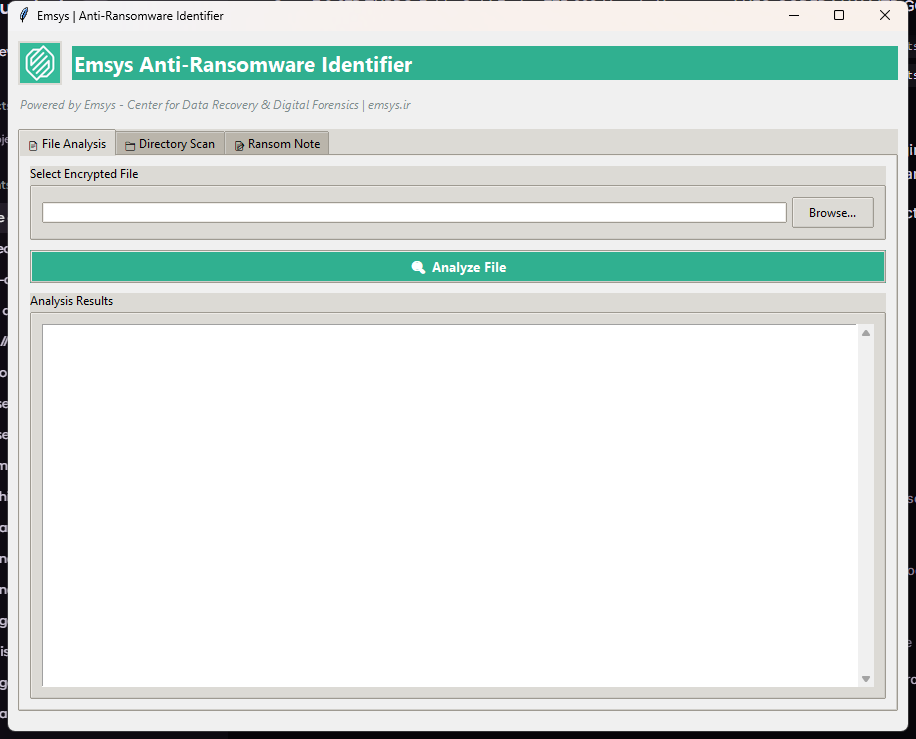
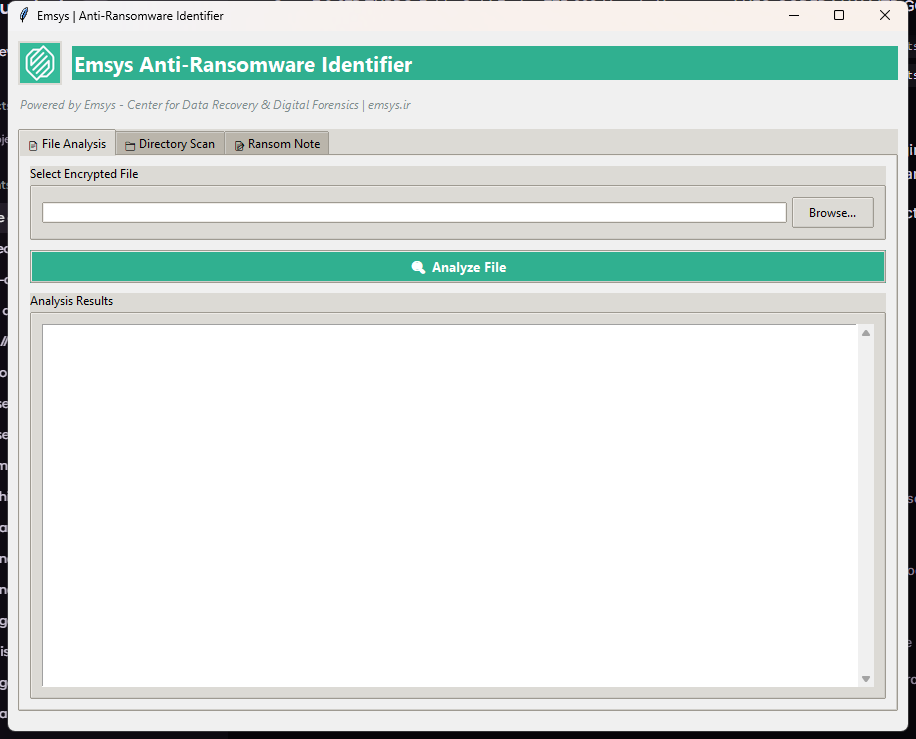

"# Emsys Anti-Ransomware Identifier

A cross-platform anti-ransomware identification system with both CLI and GUI interfaces. Examines encrypted files and ransom notes to identify the ransomware family using extension matching, content analysis, and file signature detection. Built with Python and Tkinter for a native-looking desktop experience.

## Features

- **Extension Matching**: Checks file extensions against a database of 40+ known ransomware families
- **Ransom Note Analysis**: Analyzes ransom note content for family-specific keywords and signatures
- **File Signature Detection**: Checks magic bytes and entropy to detect encrypted files
- **Directory Scanning**: Recursively scans directories for affected files and ransom notes
- **Decryptor Links**: Provides links to relevant decryption tools and resources

## Screenshots

### File Analysis Tab
Analyze a single encrypted file to identify the ransomware family.



### Directory Scan Tab
Recursively scan directories for affected files and automatically detect ransom notes.


### Ransom Note Analyzer Tab
Analyze ransom note content for family-specific signatures and keywords.



## Supported Ransomware Families

LockBit, REvil/Sodinokibi, Dharma/CrySiS, DarkSide, Conti, NetWalker, Babuk, WannaCry, Petya/NotPetya, GoldenEye, CryptoLocker, GandCrab, STOP/DjVu, Phobos, 8-Base, The Gentlemen, Beelzebub, and more.

## Usage

### Command Line Interface (CLI)

```bash
# Analyze a single file
python ransom_id.py encrypted_file.docx.lockbit

# Scan a directory for encrypted files
python ransom_id.py /path/to/affected/folder

# Analyze a ransom note specifically
python ransom_id.py --note README_DECRYPT.txt
```

### Graphical User Interface (GUI)

Launch the interactive GUI application:

```bash
python ransom_id_gui.py
```

The GUI provides three tabs:
- **📄 File Analysis** - Analyze a single encrypted file
- **📁 Directory Scan** - Recursively scan a directory for affected files and ransom notes
- **📝 Ransom Note** - Analyze ransom note content for family-specific signatures

Features include browse dialogs, real-time results display, progress indicators, and detailed analysis output.

## How It Works

1. **Extension Analysis**: Matches file extensions against known ransomware extension patterns, including variants with ID suffixes
2. **Content Analysis**: Searches ransom notes for family-specific keywords and phrases
3. **Signature Detection**: Examines file headers and entropy to identify encrypted content
4. **Resource Links**: Provides URLs to NoMoreRansom.org, Emsisoft, Kaspersky, and other decryptor resources

## Database Sources

- NoMoreRansom.org collaborative database
- Emsisoft ransomware decryption tools catalog
- Kaspersky No Ransom portal
- Bitdefender threat intelligence (Q4 2026)

## Limitations

- New ransomware variants released after the database update may not be recognized
- Some ransomware families use random extensions that cannot be matched
- Decryption tool availability varies by family and variant version

## References

- [NoMoreRansom.org](https://nomoreransom.org/)
- [Emsisoft Decryptors](https://www.emsisoft.com/en/ransomware-decryption/)
- [Kaspersky No Ransom](https://noransom.kaspersky.com/)
- [Bitdefender Threat Debrief](https://www.bitdefender.com/research/)"  
